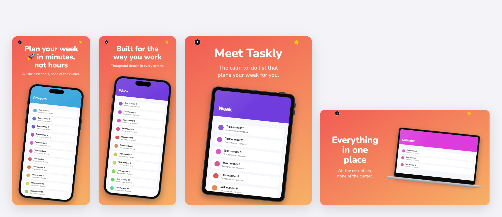
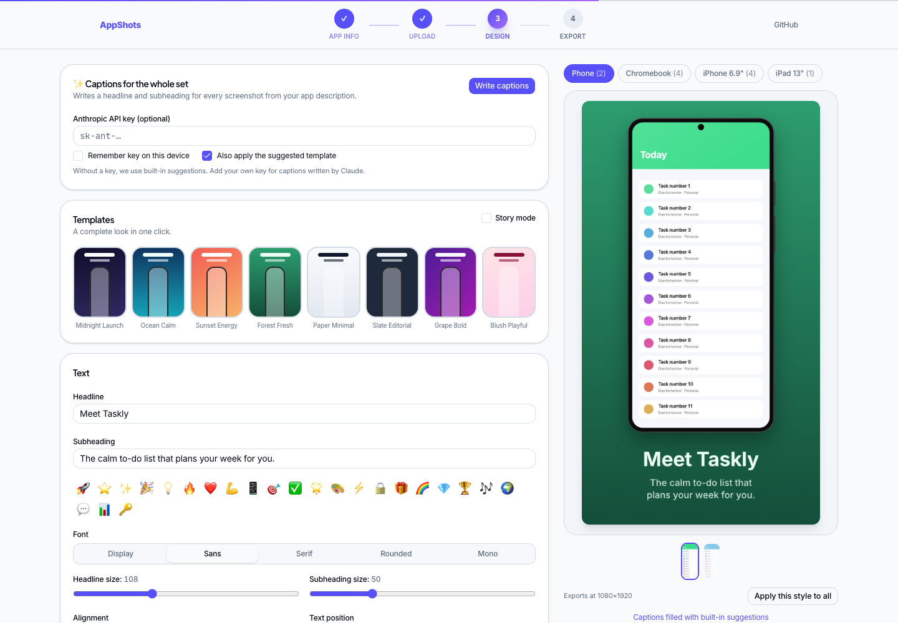

# AppShots

**Store-ready App Store and Google Play screenshots, made in your browser.**

Drop in raw simulator screenshots, pick a look, and download a ZIP of polished marketing screenshots: device frames, headlines, gradients and stickers, at the exact resolutions each store accepts. No account, no upload, no server. Your screenshots never leave your machine.

**[Try it at appshots.portfolio.ltd →](https://appshots.portfolio.ltd)**

[](https://github.com/portfolio-ltd/appshots/actions/workflows/ci.yml)
[](LICENSE)



## Features

- **Exact store sizes.** Every export matches an accepted resolution: iPhone 6.9″/6.5″/6.3″/6.1″, iPad 13″/11″/mini, Apple Watch, and Play phone, 7″/10″ tablet, Chromebook and Android XR. Store count limits are checked before export, and files over Google Play's size limits are re-encoded as JPEG automatically.
- **What you see is what you export.** The editor preview and the export use the same canvas renderer, so they cannot drift apart.
- **Real device frames.** iPhone with Dynamic Island, Android phones with a punch-hole camera, iPad, Android tablets, a Chromebook-style laptop and Apple Watch, all drawn in code. You can also use a floating card or a full-bleed layout.
- **Typography that holds up.** Five bundled open-source fonts with auto-fit and balanced line wrapping, plus colour emoji.
- **Templates and story mode.** One-click looks. Story mode applies a template to the whole set and numbers each screenshot.
- **Captions for the whole set.** Built-in suggestions work offline. With your own Anthropic API key, Claude writes captions from your app description. The key goes straight from your browser to `api.anthropic.com` and nowhere else.
- **Drafts survive reloads.** Settings live in `localStorage` and screenshots in IndexedDB, on your device only.



## Quick start

The quickest way is to use the hosted version at **[appshots.portfolio.ltd](https://appshots.portfolio.ltd)**. It's the same code as this repo, and everything still runs in your browser.

To run it locally (requires Node.js 20+):

```bash
git clone https://github.com/portfolio-ltd/appshots.git
cd appshots
npm install
npm run dev
```

Open <http://localhost:3000>. No environment variables or accounts are needed.

## How it works

1. **App info.** Name, description and category, plus the stores and devices you're targeting.
2. **Upload.** Add raw screenshots per device (PNG, JPEG or WebP, any resolution). The order you add them is the order they're exported in.
3. **Design.** Each screenshot has its own design. Use templates, "Apply this style to all" or story mode to keep the set consistent.
4. **Export.** Review every output against the store checklist, then download one ZIP:

```
app-store/iphone-6.9/01.png   1320×2868
app-store/ipad-13/01.png      2064×2752
play-store/phone/01.png       1080×1920
play-store/chromebook/01.png  1920×1080
…
```

## Deploying

AppShots is a fully static site (`output: "export"`). `npm run build` writes everything to `out/`, which you can host anywhere:

- **Vercel / Netlify / Cloudflare Pages:** import the repo. The defaults work.
- **GitHub Pages or any sub-path:** build with `NEXT_PUBLIC_BASE_PATH=/your-repo npm run build`.

## Project layout

```
app/                 Pages: landing, onboarding, upload, customise (editor), export
components/          DesignCanvas (live preview), controls, shadcn/ui primitives
lib/render/          The renderer — pure layout + geometry, and canvas drawing
lib/constants.ts     Device specs (output sizes, frames, store limits), templates
lib/export.ts        Full-resolution render, size-limit handling, ZIP
lib/autodesign.ts    Caption generation (local heuristic + Claude BYOK)
lib/persist.ts       Draft storage (localStorage)
lib/files.ts         Screenshot storage (IndexedDB)
tests/               Vitest unit tests for layout, wrapping and specs
```

The renderer is split so the hard parts are testable without a browser. `lib/render/layout.ts` and `lib/render/geometry.ts` are pure functions that take a `measure` callback. `lib/render/draw.ts` is the only code that touches a canvas.

## Development

| Task | Command |
|---|---|
| Dev server | `npm run dev` |
| Unit tests | `npm test` |
| Type check | `npm run typecheck` |
| Lint | `npm run lint` |
| Production build | `npm run build` |

See [CONTRIBUTING.md](CONTRIBUTING.md) for how to add a device or template, and for the pull request checklist.

## Store requirements

Output sizes follow Apple's [screenshot specifications](https://developer.apple.com/help/app-store-connect/reference/screenshot-specifications) and Google Play's [preview asset guidelines](https://support.google.com/googleplay/android-developer/answer/9866151). Stores change these occasionally. If you spot a mismatch, please [open an issue](https://github.com/portfolio-ltd/appshots/issues).

AppShots is not affiliated with Apple or Google. Device frames are generic illustrations drawn in code.

## License

[GNU AGPL-3.0](LICENSE) © Sagar Chand Agarwal and contributors. You're free to use, modify and self-host AppShots. If you run a modified version as a public service, you must publish your changes under the same license.
